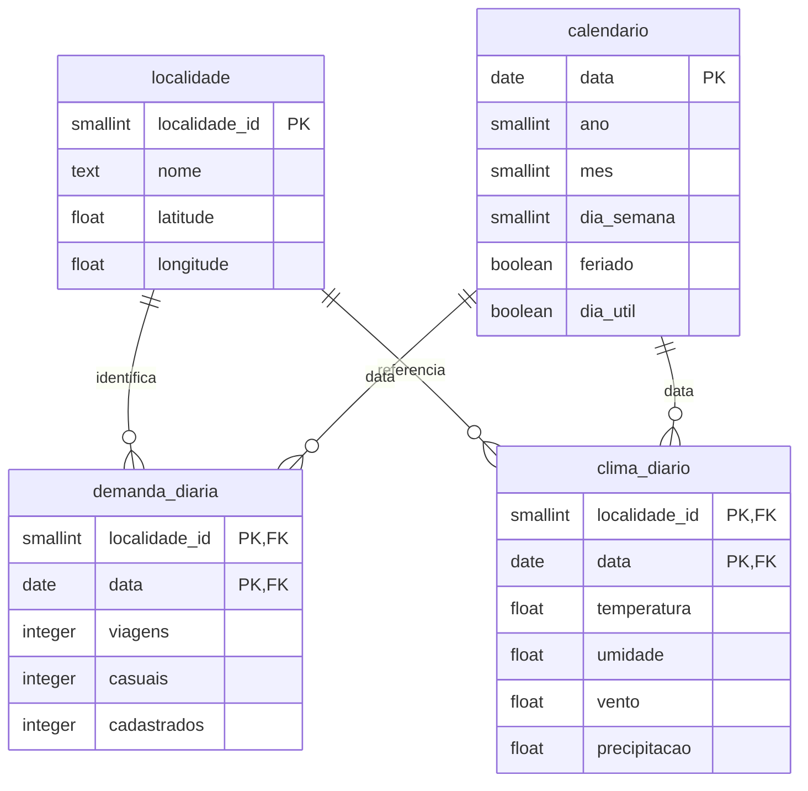

# Modelagem PostgreSQL

Banco persistente `mobilidade`; schema `mobilidade`. Grão: uma localidade agregada por dia. A tabela de localidades permite identificar explicitamente a aproximação espacial utilizada, sem atribuir viagens a estações inexistentes na fonte.

`carga_fonte` registra URL, hash, número de registros e horário de carregamento de cada fonte. A view `dataset_integrado` faz o JOIN das duas tabelas fato pelas chaves e acrescenta calendário; exclui as parcelas do alvo e clima da UCI.

Chaves primárias impedem duplicação no grão definido. Chaves estrangeiras impedem datas/localidades órfãs. CHECKs validam valores não negativos, limites meteorológicos e `viagens = casuais + cadastrados`. Os índices implícitos das PK atendem ao volume e às junções; não se criam índices redundantes.

O ETL usa uma transação: falha em qualquer carga desfaz toda a atualização. Reexecução atualiza dimensão e substitui apenas fatos da localidade 1, sem duplicar registros. Não usa DROP SCHEMA nem TRUNCATE CASCADE. Mudanças futuras de schema devem ser feitas por migrações explícitas; CREATE IF NOT EXISTS não migra definições já existentes.

## Ambiente persistente

No Windows, `prepare_postgres.ps1` cria cluster dedicado em `runtime/pgdata` e autentica por **SSPI**, mapeando somente a conta Windows que inicializou o cluster. O servidor escuta apenas em `127.0.0.1:55433`; o arquivo `pg_hba.conf` não mantém autenticação trust. Nenhuma senha é gravada no Git.

O cluster permanece no disco entre execuções. O script inicia e para o processo sem instalar serviço Windows. Não há autoinicialização ao ligar o computador; execute o script quando precisar do banco. `-Stop` encerra o servidor e preserva os dados.

O papel `integrador` é administrador somente deste cluster acadêmico separado. Em ambiente multiusuário/produção, separe proprietário e usuário ETL com privilégios mínimos, configure backups, TLS e autenticação apropriada. Alternativamente use PostgreSQL existente com `DATABASE_URL`; forneça credenciais no ambiente, nunca nos arquivos versionados.
